<div align="center">

# Sanjeevani Virtual Health

**Care that goes home with the patient.**
One prescription becomes a plain-language care plan, a phone call that explains it, a booked follow-up visit and a doorstep delivery, run by AI agents that can only act through tools.

[Demo video (2 min 18 s)](https://drive.google.com/file/d/1jplwrze2LtuyMAzKMXrHo9LmZGkjmxbU/view?usp=drive_link)
&nbsp;&nbsp;|&nbsp;&nbsp;
[Build 2036 deck](assets/presentation/Sanjeevani_Build2036_Deck.pptx)
&nbsp;&nbsp;|&nbsp;&nbsp;
[Documentation](docs/README.md)

<a href="https://drive.google.com/file/d/1jplwrze2LtuyMAzKMXrHo9LmZGkjmxbU/view?usp=drive_link">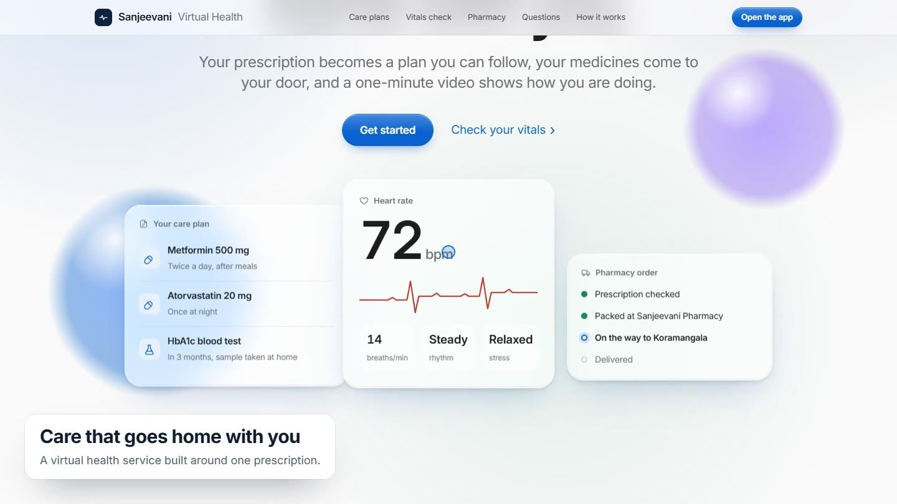</a>

</div>

---

## Contents

- [The problem](#the-problem)
- [What it does](#what-it-does)
- [How it fits together](#how-it-fits-together)
- [Agentic AI](#agentic-ai)
- [A patient's journey](#a-patients-journey)
- [Identity verification (KYC)](#identity-verification-kyc)
- [Vitals check](#vitals-check)
- [Screenshots](#screenshots)
- [Design in Figma](#design-in-figma)
- [Repository layout](#repository-layout)
- [Getting started](#getting-started)
- [Testing](#testing)
- [Responsible AI, security and privacy](#responsible-ai-security-and-privacy)
- [Technology](#technology)

---

## The problem

Patients leave a consultation with a prescription they only half understood. Doses get mixed up, courses stop early, follow-up visits are missed and nobody notices until the patient is back, sicker. Hospitals have the data but no affordable way to stay with every patient after they walk out of the door.

Sanjeevani closes that gap with two products that work as one:

| | Care-plan web app | Voice platform |
|---|---|---|
| **For** | Patients, families and care staff | Patients on an ordinary phone |
| **Does** | Reads the prescription, writes the plan, answers questions, orders medicines, books visits, runs a vitals check | Calls the patient to explain the plan, takes calls, books doctors, orders medicines, collects feedback |
| **Built with** | FastAPI, MongoDB, Gemini vision, a CPU vitals engine | FastAPI, Gemini Live, PostgreSQL, Redis, Qdrant, Next.js |
| **Folder** | [`care-plan-app/`](care-plan-app) | [`voice-platform/`](voice-platform) |

## What it does

| Area | Feature |
|---|---|
| **Care plan** | Upload a photo, PDF or text of a prescription; get every medicine with dose, timing and end date, a follow-up visit and diet advice, in plain words |
| **Voice agent** | One phone number; a front desk routes to appointment, pharmacy, feedback and patient-care desks; every fact it says comes from a tool |
| **Outbound care calls** | After a prescription, the agent calls in calling hours, confirms identity, explains each medicine and records whether it was understood |
| **Booking** | Doctors, free times and the fee after insurance; booked by phone or in a few taps, with a reference read back |
| **Pharmacy** | Medicines checked against the e-prescription, payment link, delivery or pick-up |
| **Text assistant** | Answers questions from the patient's own plan only; never diagnoses or changes a medicine |
| **KYC** | Aadhaar Secure QR with UIDAI signature check, live selfie and face match, started from inside the call |
| **Vitals check** | One minute of face video gives heart rate, breathing and seven more wellness readings, each with a confidence label |
| **Care alerts** | Refills running out or a worrying vitals estimate queue an alert; a person presses Call now |
| **Multi-tenant** | Every hospital is a tenant with its own data, numbers, documents and storage |

## How it fits together

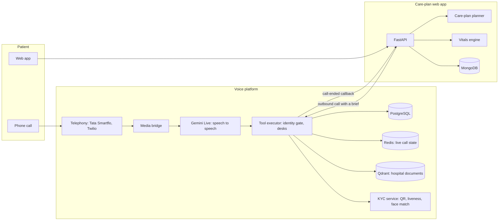

The two apps talk over REST with an API key per hospital: the web app starts outbound calls and books directly; the voice platform reports each call's outcome back. A fallback voice path (Pipecat with separate speech-to-text, language model and text-to-speech) uses the same tools and rules.

More: [docs/architecture.md](docs/architecture.md)

## Agentic AI

Eight specialised agents work as one closed loop. Each one plans, acts only through its own tools, and hands work to the next. A person stays in charge of every call.

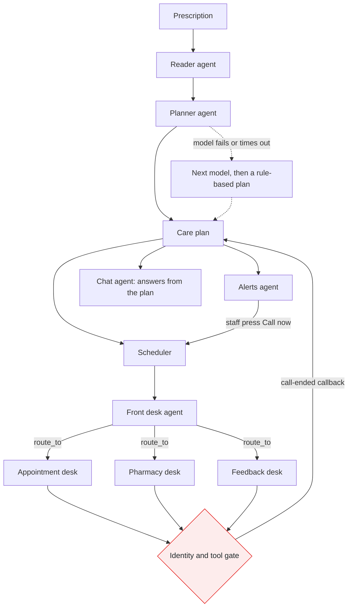

| Agent | Acts through | Guardrail |
|---|---|---|
| Front desk | `route_to` | Finds the need; never answers medical questions itself |
| Appointment desk | `find_doctors`, `quote_visit_cost`, `book_doctor_appointment` | A time that was never offered is refused; a taken time is not offered again |
| Pharmacy desk | `start_medicine_order`, `send_payment_link`, `schedule_delivery` | Orders only what the e-prescription allows |
| Feedback desk | `record_visit_feedback` | An unhappy answer raises a follow-up for a person |
| Patient care (outbound) | `confirm_identity`, `get_prescription_context`, `record_understanding`, `request_doctor_meeting` | Nothing about the medicines is shared before the date-of-birth check passes |

More: [docs/voice-agent.md](docs/voice-agent.md)

## A patient's journey

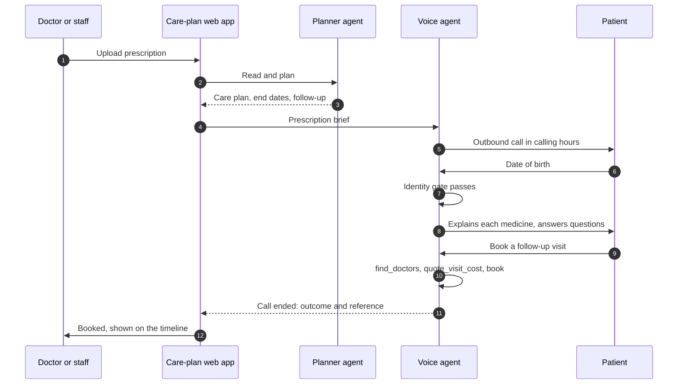

## Identity verification (KYC)

Before a booking, the caller proves who they are on their own phone, without installing anything. The agent cannot book until the check passes.

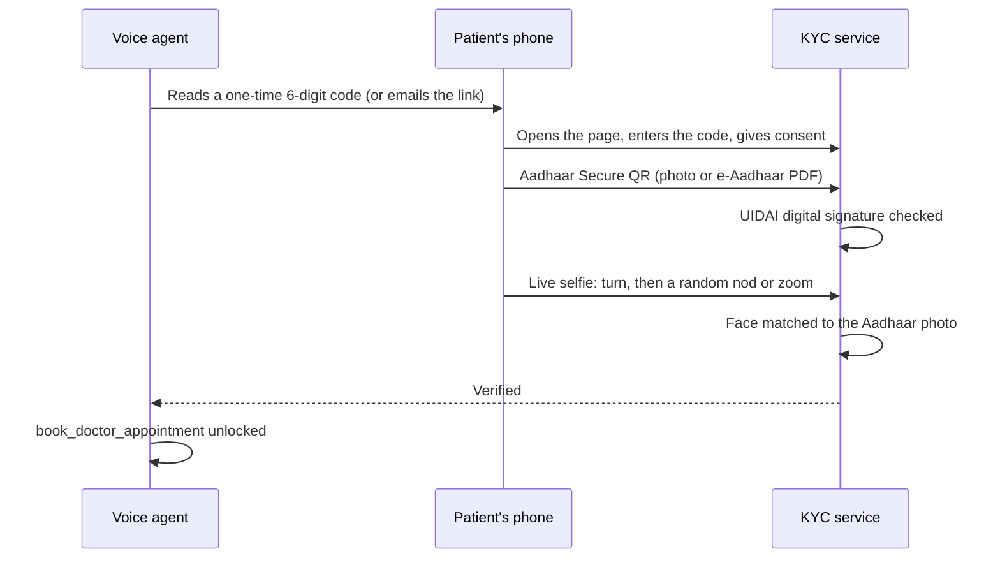

Only the name, birth year and the last four Aadhaar digits are kept; face data is wiped when the check ends and personal fields are stripped after 90 days. More: [docs/kyc.md](docs/kyc.md)

## Vitals check

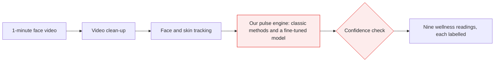

Wellness estimates, not a diagnosis. The video is deleted as soon as it has been read and the readings are never stored. More: [docs/vitals.md](docs/vitals.md)

## Screenshots

<table>
  <tr>
    <td width="50%">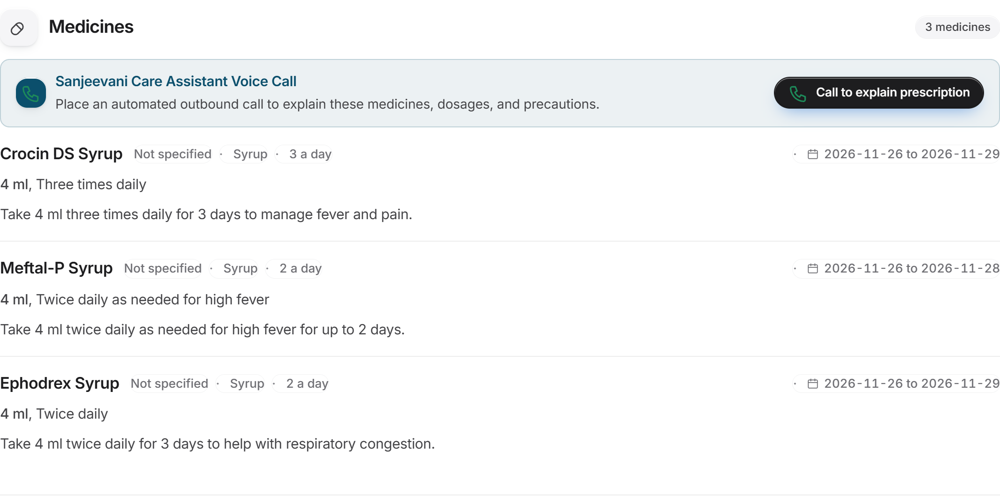<br><sub>Every medicine, dose and end date, with a call to explain them</sub></td>
    <td width="50%">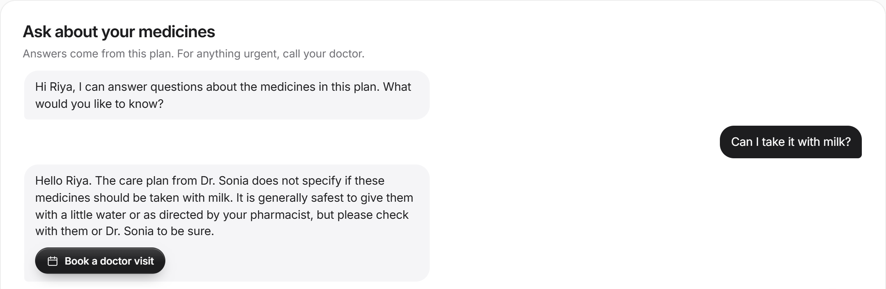<br><sub>Questions answered from the plan only</sub></td>
  </tr>
  <tr>
    <td>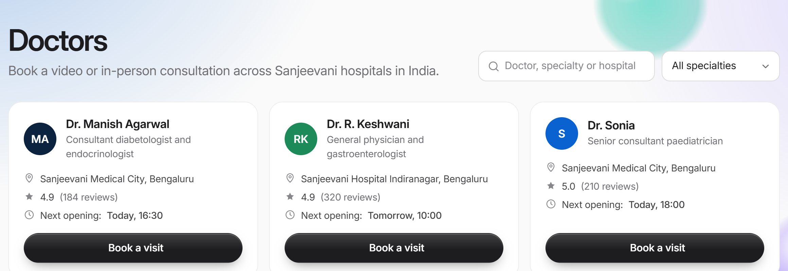<br><sub>Book a doctor in a few taps</sub></td>
    <td>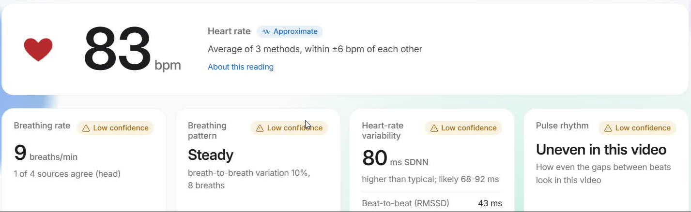<br><sub>Vitals check results with confidence labels</sub></td>
  </tr>
  <tr>
    <td>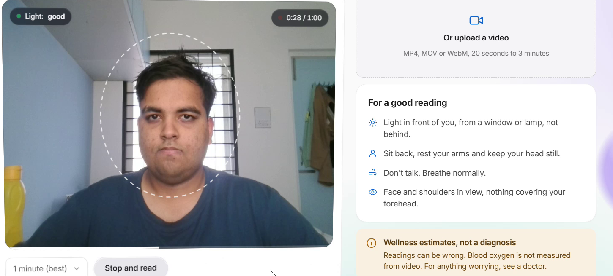<br><sub>Recording with a guide oval and a light check</sub></td>
    <td>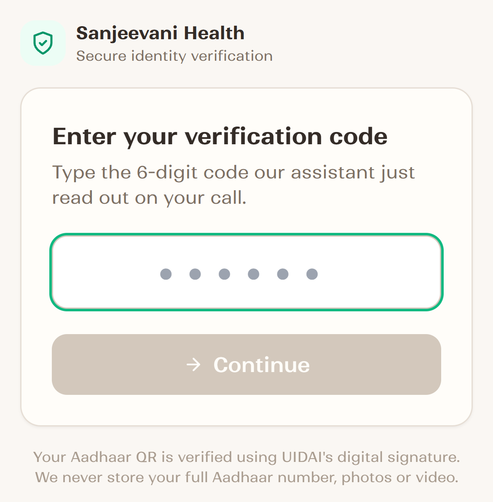<br><sub>KYC verification, opened from the call</sub></td>
  </tr>
</table>

A real booking call, with the tool behind each step: [assets/screenshots/d_transcript.png](assets/screenshots/d_transcript.png)

## Design in Figma

Every flow is written as text, generated into a FigJam board, and exported into the deck, the film and this README, so the design and the product do not drift apart. The sources are in [docs/diagrams](docs/diagrams).

| Board | FigJam | Export |
|---|---|---|
| Agent workflow | [Open in FigJam](https://www.figma.com/board/L5nyvX4Rj4g1tuRIHOXKia) | [f_agents.png](assets/diagrams/f_agents.png) |
| Patient journey | [Open in FigJam](https://www.figma.com/board/2K4GbmcOWsKRa7Hfqr3iry) | [f_journey.png](assets/diagrams/f_journey.png) |
| Vitals check overview | [Open in FigJam](https://www.figma.com/board/Gxc1Pf1Gj4v7yStntL3Vj9) | [f_vitals.png](assets/diagrams/f_vitals.png) |

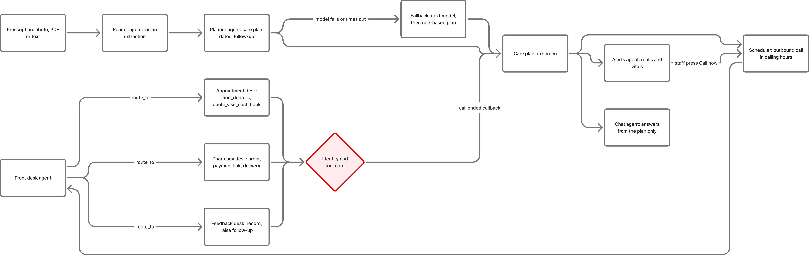

## Repository layout

```text
sanjeevani-virtual-health/
├── care-plan-app/          Care-plan web app (FastAPI, MongoDB, static front end)
│   ├── ai_brain/           Prescription reading and care-plan planning
│   ├── vitals/             Vitals engine (CPU)
│   ├── static/             Patient and staff web app
│   └── tests/
├── voice-platform/         Voice agent platform
│   ├── backend/            FastAPI: calls, agents, tools, tenants, KYC orchestration
│   ├── frontend/           Next.js console: calls, patients, bookings, KYC page
│   ├── kyc_service/        Isolated QR, liveness and face-match service
│   ├── kpi_dashboard/      Call KPI dashboard
│   ├── scripts/            Tenant setup and pre-deploy checks
│   └── docker-compose.yml
├── docs/                   Architecture, agents, KYC, vitals, security, setup
│   └── diagrams/           Mermaid sources of the FigJam boards
└── assets/
    ├── presentation/       Build 2036 deck, demo film and captions
    ├── screenshots/
    └── diagrams/           FigJam exports
```

## Getting started

Each app runs on its own. Copy its `.env.example` to `.env` and fill in your own keys; no real keys are committed.

**Care-plan web app**

```bash
cd care-plan-app
python -m venv .venv && source .venv/bin/activate      # Windows: .venv\Scripts\activate
pip install -r requirements.txt
cp .env.example .env                                    # add GEMINI_API_KEY and MONGODB_URI
python main.py                                          # http://localhost:8000, API docs at /docs
```

**Voice platform**

```bash
cd voice-platform
cp .env.example .env && cp backend/.env.example backend/.env
docker compose up --build                               # API on :8001, console on :3001
python scripts/setup_sanjeevani.py                      # create the hospital tenant, desks and demo doctors
```

Full steps, environment variables and deployment notes: [docs/getting-started.md](docs/getting-started.md)

## Testing

```bash
cd care-plan-app && pytest -q            # 96 tests
cd voice-platform/backend && pytest -q   # tenancy, desks, tools, KYC, scheduler, isolation
```

## Responsible AI, security and privacy

| Rule | How it is enforced |
|---|---|
| Identity first | No medicine detail until the date of birth matches; two wrong answers end the call |
| No invented facts | A doctor, time, fee or reference is only said if a tool returned it |
| No medical advice | Questions about other medicines or doses go to the doctor; replies that change a medicine are removed |
| Emergency exit | Emergency words stop the flow and send the person to emergency services |
| Consent and limits | Calls need consent, respect do-not-call, calling hours and daily caps |
| Data minimisation | Audit log keeps an allow-list of fields and masks phone numbers; KYC keeps the last four digits only |
| Tenant isolation | Every query, document and bucket is scoped to one hospital |
| Honest scope | Vitals are wellness estimates with confidence labels, never a diagnosis |

More: [docs/security-and-privacy.md](docs/security-and-privacy.md)

## Technology

| Layer | Choices |
|---|---|
| Voice | Gemini Live (speech to speech); fallback Pipecat with separate STT, LLM (Gemini Flash, Groq) and TTS |
| Telephony | Tata Smartflo, Twilio |
| Back ends | Python, FastAPI, SQLAlchemy, asyncio |
| Data | PostgreSQL, Redis, Qdrant with BM25, MongoDB, Google Cloud Storage |
| Care plans | Gemini vision with a model fallback chain and a rule-based fallback |
| Identity | Aadhaar Secure QR (UIDAI signature), InsightFace face match, liveness challenges |
| Vitals | Classic remote-photoplethysmography methods and a fine-tuned phone-video model on CPU |
| Front ends | Next.js 15, React 18; a static patient web app |
| Ops | Docker Compose on a GCP VM, GitHub Actions |

---

<div align="center">
<sub>Built for Build 2036. All patient data shown is sample data.</sub>
</div>
