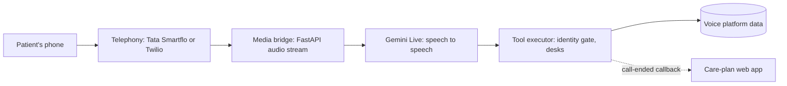

# Architecture

Sanjeevani is two applications that work as one product.

- **Care-plan web app** (`care-plan-app/`): FastAPI and MongoDB with a static web front end. It reads prescriptions, writes care plans, answers questions, runs the vitals check, raises care alerts and talks to the voice platform.
- **Voice platform** (`voice-platform/`): a multi-tenant voice agent platform. A FastAPI back end runs calls, agents and tools; a Next.js console manages tenants, numbers, patients, bookings and calls; an isolated service handles identity verification.

## A live phone call, end to end

A fallback voice path uses a Pipecat pipeline with separate speech-to-text, a language model (Gemini Flash or Groq) and text-to-speech. It uses the same tools and the same rules.

## Where data lives

| Store | Holds |
|---|---|
| PostgreSQL | Tenants, patients, appointments, prescriptions, follow-up tasks, doctor meeting requests, calls, KYC sessions |
| Redis | Live call state |
| Qdrant with BM25 | Each hospital's own documents for answers |
| Google Cloud Storage | Call recordings, one bucket prefix per hospital |
| MongoDB | Care plans, chat history, alerts and the audit log of the care-plan app |

## How the two apps talk

REST, with an API key per hospital.

| Call | Direction | Purpose |
|---|---|---|
| `POST /outbound/call` | web app to voice | Start a call with a brief (explain the prescription, book a visit) |
| `POST /patients/appointments` | web app to voice | Book a visit directly from the web app |
| `GET /patients`, `POST /patients/upsert` | web app to voice | Keep one patient directory |
| call-ended callback | voice to web app | Tell the web app how the call ended and the booking reference |

## Deployment

Docker Compose on a GCP virtual machine: API, Next.js console, PostgreSQL, Redis, Qdrant, the KYC service and a KPI dashboard. GitHub Actions run tests, a security audit and deployment.
