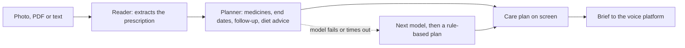

# Care-plan web app

## Prescription to care plan

The planner tries a fast model first and cuts each attempt off, so one stuck call cannot hold the request. If every model fails, a rule-based plan is produced so the patient is never left without one. Medicine end dates are calculated from the start date and the course length, not guessed by the model.

## What the patient and staff can do

| Area | What happens |
|---|---|
| Care plan | Every medicine with dose, timing and end date; a follow-up visit; diet advice |
| Call to explain | One tap asks the voice agent to phone the patient and explain the prescription |
| Text assistant | Answers questions from the plan only; never diagnoses or changes a medicine |
| Pharmacy | Medicines checked against the e-prescription; delivery or pick-up from a nearby pharmacy |
| Doctors and booking | Doctor, day and free time in a booking sheet, or Call to book |
| Vitals | A one-minute face-video check (see [vitals.md](vitals.md)) |
| Lab tests | Book a sample collection at home |
| Care alerts | Refills running out or a worrying vitals estimate queue an alert; staff press Call now |

## Care alerts

Nothing dials by itself. Before an alert call is placed, the server checks that the patient agreed to calls and is not on the do-not-call list, that it is not quiet hours, and that the patient has not already had the day's maximum of alert calls. The call brief tells the assistant never to diagnose or change a medicine, and to send anyone who sounds unwell to emergency care.

## Code map

| Module | Role |
|---|---|
| `ai_brain/extractor.py`, `ai_brain/reasoner.py` | Prescription reading and planning |
| `chat.py` | Text assistant with its own guard |
| `alerts.py` | Refill and vitals alerts, Call now |
| `voicebot.py`, `webhook.py`, `events.py` | Talking to the voice platform |
| `vitals_api.py`, `vitals/` | Vitals check |
| `audit.py`, `access_gate.py` | Audit log and access control |
