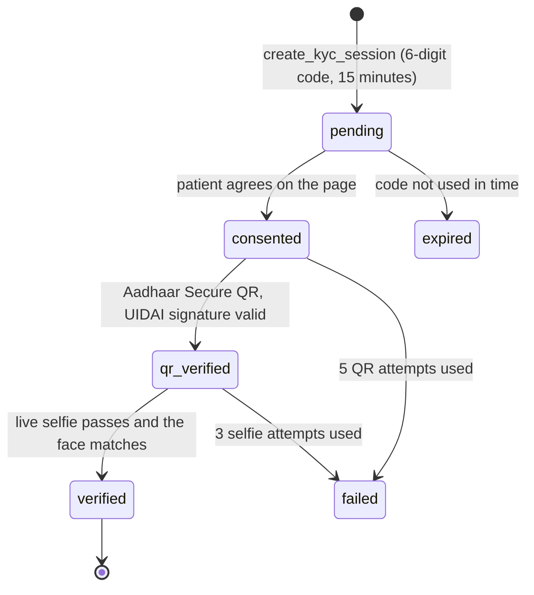

# Identity verification (KYC)

Before a booking, the caller proves who they are on their own phone. The agent cannot book until the check passes.

## Steps

1. **Code on the call.** `create_kyc_session` gives a one-time 6-digit code, valid 15 minutes, that the agent reads out. `send_kyc_link_email` can email the link with the code filled in instead.
2. **Consent.** The patient agrees on the page before any document is read.
3. **Aadhaar Secure QR.** A photo of the QR or the e-Aadhaar PDF. The UIDAI digital signature is checked against UIDAI's published certificates, and the name is compared with the caller's.
4. **Live selfie.** Look straight, turn the head left and right, then a random nod or zoom. The face is matched to the photo inside the Aadhaar QR.
5. **Booking unlocked.** `book_doctor_appointment` refuses until the check passes, then notes "Identity verified" on the booking.

## Design choices

- The heavy work (QR decoding, signature check, face match, liveness) runs in a separate, isolated service (`voice-platform/kyc_service/`). The back end only orchestrates sessions.
- If the service is down, a setting chooses between letting bookings through unverified or holding them.
- A setting can limit KYC to the web simulator while it is being tested.

## Privacy

- Only the name, birth year, gender and the last four Aadhaar digits are kept. The full Aadhaar number, photos and video are never stored.
- The face embedding and the code are wiped as soon as a session finishes.
- Personal fields are stripped from sessions older than 90 days; the audit skeleton (status, scores, timestamps) remains.
