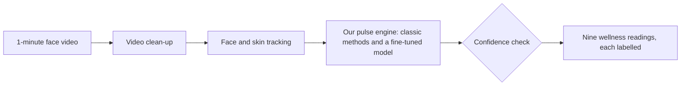

# Vitals check

A one-minute video of the face gives heart rate, breathing and seven more wellness readings. The video is deleted as soon as it has been read.

## Readings

| Reading | Shown as |
|---|---|
| Heart rate | Beats per minute |
| Breathing rate | Breaths per minute |
| Breathing pattern | Steady or uneven |
| Heart-rate variability | Milliseconds |
| Pulse rhythm | How even the gaps between beats look |
| Pulse strength | Relative, compared only with the person's own earlier readings |
| Alertness | From blinks and eye closure |
| Stress level | Relaxed, moderate or elevated |
| Blood oxygen | Not shown until calibrated with a fingertip oximeter |

## Confidence, not false precision

Every reading carries a label: reliable, approximate or low confidence. The page tells the person to use the readings for that session only and never to store them as a medical record. These are wellness estimates, not a diagnosis.

## Capturing a good reading

- Light in front of the face, from a window or lamp, not behind.
- Sit back, rest the arms and keep the head still.
- Do not talk; breathe normally.
- Face and shoulders in view, nothing covering the forehead.

The page checks the light before recording and shows a guide oval for the face. A video can also be uploaded (MP4, MOV or WebM, 20 seconds to 3 minutes).

## Privacy

The analysis runs on the server's CPU, one video at a time. The video is deleted as soon as its analysis ends, and the readings live only in memory for a short time, never in the database.
