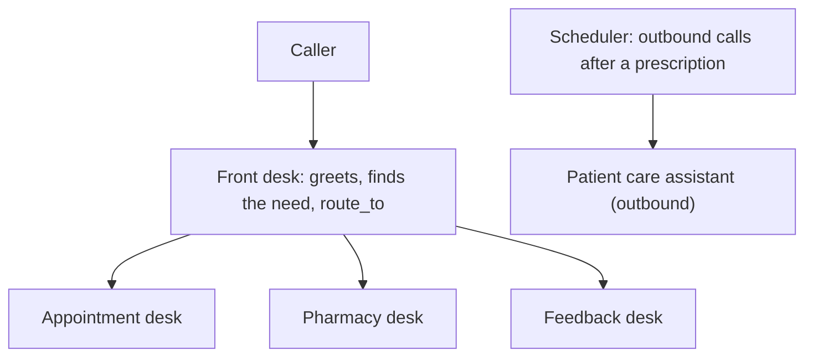

# Voice agent

One phone number. A front desk greets the caller, finds the need and routes to a desk. Each desk is its own agent with its own prompt, tools and documents, and it can only act through those tools.

## Desks and tools

| Desk | Tools |
|---|---|
| Appointment | `find_doctors`, `quote_visit_cost`, `book_doctor_appointment`, `search_knowledge` |
| Pharmacy | `start_medicine_order`, `send_prescription_link`, `send_payment_link`, `schedule_delivery` |
| Feedback | `check_feedback_eligibility`, `record_visit_feedback` |
| Patient care (outbound) | `confirm_identity`, `get_prescription_context`, `look_up_care_information`, `record_understanding`, `record_feedback`, `request_doctor_meeting`, `schedule_callback`, `mark_do_not_call` |
| Identity | `create_kyc_session`, `send_kyc_link_email`, `get_kyc_status` |

## Appointment desk

1. `find_doctors` matches the symptoms to a specialty and lists a senior and a standard doctor with fees and the next free times. The problem is read back first.
2. `quote_visit_cost` works out the fee, what the insurer pays and what the patient pays.
3. `book_doctor_appointment` books a free time and gives the booking reference. A new caller becomes a patient, one record per number.
4. The desk offers a medicine order next, or hands the caller back.

Guardrail: a time that was never offered is refused, and a taken time is not offered again.

## Patient care assistant (outbound)

Starts when the scheduler places a call after a prescription, in calling hours, with retries and caps.

1. `confirm_identity` checks the date of birth against the record.
2. `get_prescription_context` fetches the medicines, doses and cautions to explain.
3. `look_up_care_information` answers questions from the hospital's own documents.
4. `record_understanding` records, medicine by medicine, whether the patient understood.
5. `record_feedback` saves whether it was taken, whether it helped and any side effects; an unhappy answer raises a ticket.
6. `request_doctor_meeting`, `schedule_callback` and `mark_do_not_call` handle the rest.

Guardrail: nothing about the medicines is shared, and no prescription is read, before the date-of-birth check passes. An emergency symptom or a request for a person transfers the call to a human.

## The rule that holds everywhere

A doctor, a time, a fee or a booking reference is only said if a tool returned it, so the model cannot invent one. Every desk is scoped to one hospital (tenant).
